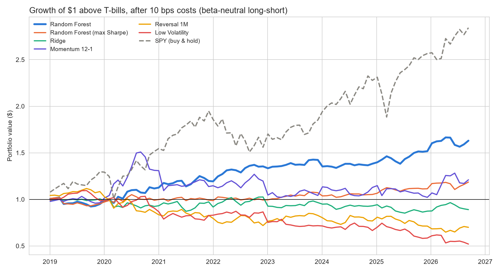
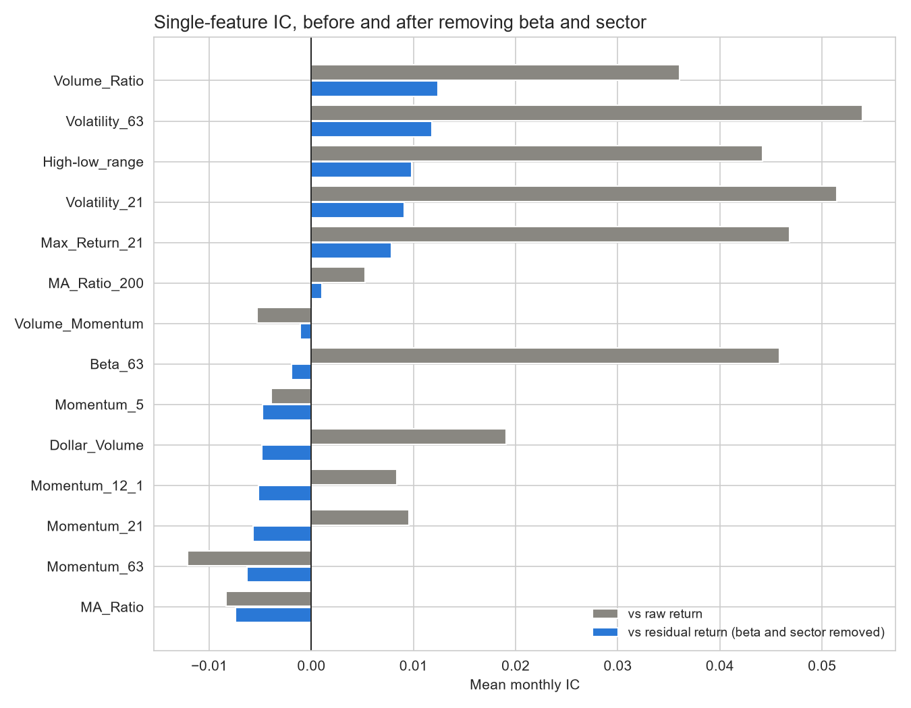
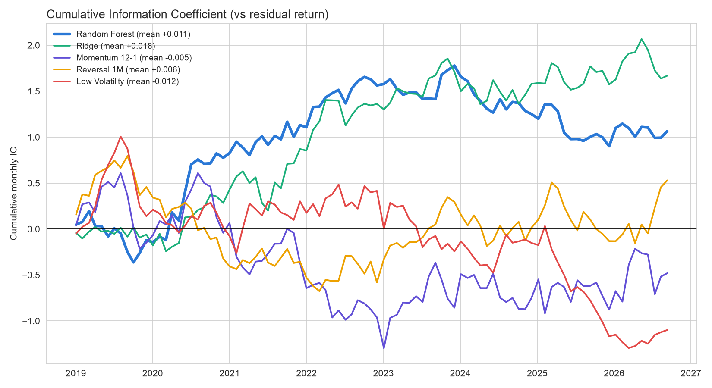

# Market-Neutral Stock Ranking with Machine Learning

Can machine learning pick stocks once you take the market out of the picture? This project ranks 104 large-cap U.S. stocks by their expected stock-specific return over the next month, then tests a beta-neutral long-short portfolio built from those rankings. The test is walk-forward (2019 to 2026, 93 monthly rebalances) and net of transaction costs.

## Key results

| Strategy (2019–2026, net of costs) | Annual excess return | Sharpe | Max drawdown | Beta to SPY | Alpha (annual) | Alpha t-stat |
|---|---|---|---|---|---|---|
| Random Forest, beta-neutral | 6.5% | 0.79 | −9.4% | −0.02 | 6.9% | 2.22 |
| SPY buy & hold | 14.4% | 0.84 | −22.6% | 1.00 | — | — |

- The Random Forest strategy had essentially no market exposure (beta −0.02, correlation with SPY −0.03) and made money in both up and down markets: +0.4% in the average up month and +0.8% in the average down month. In 2022, when SPY fell 16% (above T-bills), it gained 13.5%.
- It was positive in 6 of 8 calendar years, with a similar Sharpe ratio in the first and second half of the test (0.88 vs 0.70).
- But the signal is weak and not statistically proven. The model's monthly Information Coefficient is only 0.011 (t approx. 1.0), a Ridge model trained on the same target lost money, and several strategies were tested, so one reaching t approx. 2 can happen by chance. Treat it as a promising but unconfirmed signal.



## How the project evolved

The first version ranked stocks by their raw next-month return. It looked strong: about 11% a year with a Sharpe ratio similar to the market. A regression on SPY told a different story. The portfolio had a beta of about 0.45, and once market exposure was accounted for, its alpha was not significant. Looking at the features explained why: the strongest predictors were all risk measures (volatility, beta, biggest daily gain).
In a strong bull market, the model had simply learned to buy high-beta stocks and short low-beta ones.Hedging that beta cut the return roughly in half.

So the final version changes the question. Instead of asking which stocks will go up the most, it asks which stocks will beat what their market exposure and sector would predict:

1. Residual target: next-month return minus beta × SPY's return, minus the stock's sector average.
2. Beta-neutral portfolios: the long and short legs are sized so the portfolio's beta is zero.
3. Alpha regression on SPY for every strategy, so market exposure can't hide in the results.

The chart below shows the problem clearly: features that looked predictive against raw returns lose most of their signal once beta and sector are removed.



## Method

**Data.** Daily prices for 104 large-cap U.S. stocks across 11 sectors, SPY and the 13-week T-bill yield, 2012 to 2026, from Yahoo Finance (`yfinance`).

**Features.** All use only information available on that day, and are ranked against the other stocks on the same day so they are comparable across time.

| Group | Features |
|---|---|
| Momentum | 5, 21 and 63-day returns; 12-1 month momentum |
| Trend | Price vs 21-day and 200-day moving average |
| Risk | 21 and 63-day volatility; biggest daily gain in the past month; average high-low range; 63-day beta |
| Volume / size | Volume vs 21-day average; volume momentum; average dollar volume |

**Target.** Rank of the stock's residual return over the next 21 trading days (market and sector removed).

**Models.** Random Forest (main model) and Ridge regression, compared with three classic factor rules: 12-1 momentum, 1-month reversal and low volatility.

**Walk-forward training.** Each test year is predicted by models trained only on earlier data, with a 21-day gap (embargo) so no training target overlaps the test period. Ridge hyperparameters are tuned with time-ordered cross-validation that has the same gap.

**Portfolio.** Every 21 trading days: long the 10 highest-ranked stocks, short the 10 lowest, beta-neutral, 10 bps transaction cost per unit of turnover. I also tested a max-Sharpe version (Ledoit-Wolf covariance, beta = 0 constraint). It returned 2.2% a year, less than simple beta-neutral weights.

**Evaluation.** Monthly Information Coefficient (rank correlation between predictions and actual residual returns), quintile spreads, and portfolio statistics including alpha and beta from a regression on SPY.

## How I checked the pipeline

- Placebo test on random-walk prices. During development I ran the whole pipeline on simulated prices where nothing is predictable. The models' ICs came out close to zero, which shows no information from the future leaks into the predictions.
- Leftover beta. The placebo test also showed the "beta-neutral" portfolios still had some market exposure when hedged with a 63-day beta. Short-window betas are noisy: stocks with very high or very low estimates usually have a true beta closer to 1. Hedging with a 252-day beta shrunk toward 1 (Blume adjustment) fixed it.
- Embargo and purged cross-validation, so overlapping 21-day targets can't leak between training and testing.
- Newey-West t-stats for the IC, because signals that barely change from month to month produce autocorrelated ICs, which make the normal t-stat look better than it should.

## Signal quality



| Signal | Mean IC | t-stat (Newey-West) | % months IC > 0 |
|---|---|---|---|
| Random Forest | 0.011 | 0.97 | 51% |
| Ridge | 0.018 | 1.73 | 57% |
| Momentum 12-1 | −0.005 | −0.34 | 51% |
| Reversal 1M | 0.006 | 0.40 | 52% |
| Low Volatility | −0.012 | −0.79 | 45% |

None of the signals is statistically significant on its own. The Random Forest's portfolio result comes mostly from the extremes of its ranking: the top quintile beat the bottom quintile by 0.67% a month in residual return, while the middle quintiles showed no clear pattern.

## How it could be used

Because the strategy has almost no correlation with the market, it is more useful as a diversifying satellite next to an index fund than as a standalone portfolio. Blending it with SPY over the test period:

| Portfolio (2019–2026) | Annual excess return | Volatility | Sharpe | Max drawdown |
|---|---|---|---|---|
| 100% SPY | 14.4% | 18.2% | 0.84 | −22.6% |
| 80% SPY / 20% Random Forest | 13.2% | 14.6% | 0.93 | −18.2% |
| 70% SPY / 30% Random Forest | 12.5% | 12.9% | 0.98 | −16.3% |

Adding the strategy lowered volatility and drawdowns and raised the Sharpe ratio, at the cost of some return. This is only an illustration: the blend weights were picked after seeing the results, and the strategy's signal itself is not statistically proven.

## Limitations

- Survivorship bias: the universe is today's large caps, so stocks that shrank or were delisted since 2012 are missing. This probably flatters the results.
- Multiple testing: six strategies were compared; one reaching t approx. 2 is not strong evidence on its own.
- Dependence on a few months: three of the five best months were during the 2020 COVID swings. Without the best three months, the Sharpe ratio drops from 0.79 to 0.56.
- The signal faded recently: the Random Forest's IC was negative in 2024 and 2025.
- Simplified trading: trades at the close, flat costs, no short-borrowing fees, no intra-month rebalancing.

## What I would do next

- Use a survivorship-free universe (historical index constituents).
- Add point-in-time fundamental data (valuation, quality, earnings revisions).
- Test longer holding periods and lower-turnover versions to cut costs.
- Run the same pipeline on a different market to see if the signal holds out of sample.

## Repository

| File | What it is |
|---|---|
| `Stock_ranking_ML.py` | Full pipeline: data, features, walk-forward training, backtest, charts |
| `results_summary.ipynb` | Summary of the results with tables and charts (reads the `results` folder) |
| `results/` | Tables (CSV) and charts (PNG) saved by the model |
| `requirements.txt` | Python packages |

## How to run

```
pip install -r requirements.txt
python Stock_ranking_ML.py
```

The first run downloads prices and caches them in `data/`. A full run takes a few minutes. Then open
`results_summary.ipynb` and run all cells to see the summary.

**Author: Duc Minh (Alex) Nguyen**